# 实践课1：个人实验报告（Pi Agent 安装与使用）

## 1. 基本信息

- GitHub 登录名：3478415652

- 个人仓库地址：[https://github.com/3478415652/pi-agent-practice](https://github.com/3478415652/pi-agent-practice)

- 实验环境：Windows 11 · Windows Terminal（PowerShell 7）· Pi **1.5.0**（`@earendil-works/pi-coding-agent`）

- 可用模型：`deepseek-v4-flash`（默认）、`qwen-3.8-27b`（支持思考级别）、`gemma-4`（唯一支持图片输入）、`glm-5.3-flash`

## 2. 实践过程与关键截图

### 2.1 任务一：本地安装并启动（S1）

按说明使用安装脚本 `powershell -c "irm https://pi.dev/install.ps1 | iex"` 安装，安装器把 Pi 放到托管目录并把启动器写进用户 PATH。

在项目目录启动：

```powershell
cd D:\project\git\pi-agent-practice
pi
```

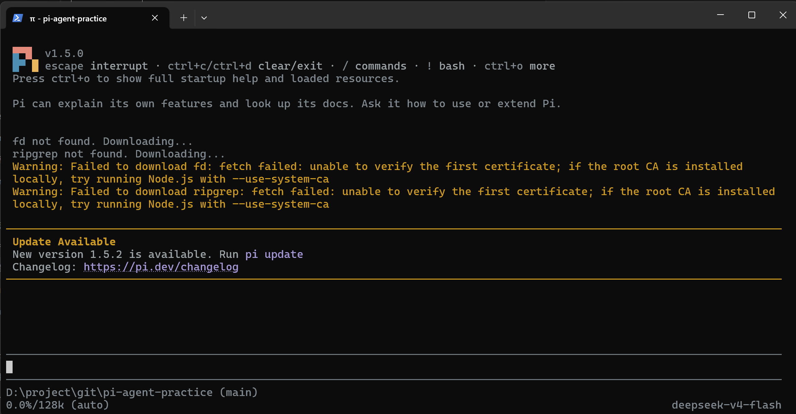

截图说明：左上角显示版本号 `v1.5.0`，底部状态栏显示当前工作目录 `D:\project\git\pi-agent-practice (main)` 和默认模型 `deepseek-v4-flash`，可证明客户端已成功启动、版本与工作目录均正确。画面中的两条黄色 `Warning: Failed to download ripgrep / fd`（证书校验失败）与 `Update Available 1.5.2` 都不影响使用。

### 2.2 任务二：配置模型并完成一次会话（S2）

用户级配置在 `D:\APP\PiAgent\`。`models.json` 声明一个名为 `hunnu` 的 OpenAI 兼容 provider：`baseUrl` 为网关，`api` 为 `openai-completions`，`apiKey` 内联，并设置 `compat.supportsDeveloperRole=false`、`maxTokensField=max_tokens`，四个模型的 `contextWindow` 为 128000、`maxTokens` 为 8192。`settings.json` 指定默认 provider/model 为 `hunnu` / `deepseek-v4-flash`，默认思考级别 `off`。

配置完成后在会话中发送提示词 `hello`：

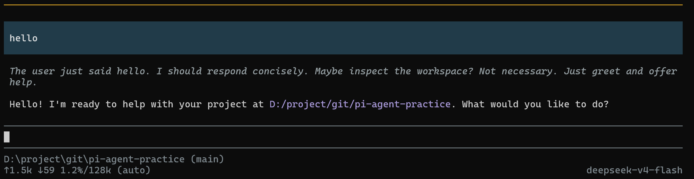

截图说明：画面包含自己发出的提示词 `hello`、模型的思考段与实际回复，底部状态栏显示当前模型 `deepseek-v4-flash`。

### 2.3 任务三：切换模型与思考级别（S3）

用 `/model`把模型从 `deepseek-v4-flash` 切到 `qwen-3.8-27b`，再发送问题“请用一句话解释持续集成”验证会话正常：

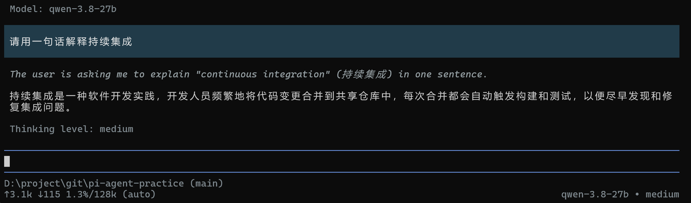

截图说明：顶部显示 `Model: qwen-3.8-27b`，中部是问题与回复，底部状态栏 `qwen-3.8-27b • medium`。切换前的模型状态见图 S2 底部。

随后用 `/thinking` 把思考级别从 `medium` 调到 `high`：

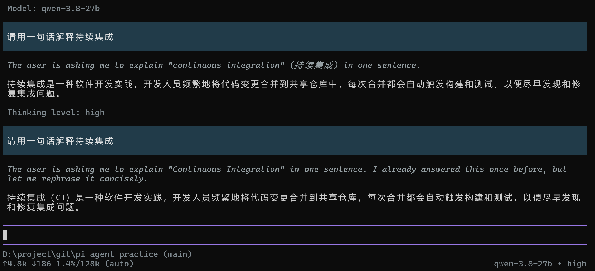

截图说明：第一张图是 `Thinking level: medium` 的回复，再出现切换后 `Thinking level: high` 的回复，底部状态栏变为 `qwen-3.8-27b • high`，切换前后状态可直接对比。

**任务复杂度如何影响选择**：

简单任务（事实问答、改写一句话、翻译）用 `off` 或 `low`，一次推理就能答，级别调高只会更慢、更费 token，回答还容易变啰嗦；中等任务（解释一个函数、读一个文件写小结、常规代码问答）用 `medium`，需要几步推理但路径清晰，速度与质量平衡；复杂任务（多文件排查报错根因、长上下文比对、方案取舍、多步脚本）才用 `high` / `xhigh`，这类任务要先列假设、再验证、再修正，推理预算不足容易漏分支，此时多等几十秒是值得的。

同时，模型与级别是两件事：能力边界先定模型（要读图只能用 `gemma-4`，要调级别只能用 `qwen-3.8-27b`），复杂度只决定同一个模型烧多少推理预算。所以流程是先按任务类型选模型，再按难度挑档位；级别高不代表答案更好，默认 `off`，按难度逐级往上加。

### 2.4 任务四 A：使用 @ 引用代码文件（S4）

练习文件 `pi-test/hello.py`：

```python
def add(a, b):
    return a + b

print(add(2, 3))
```

在 `pi-test` 目录启动 Pi，并用官方支持的命令行 `@文件` 形式引用：

```powershell
cd D:\project\git\pi-agent-practice\pi-test
pi "@hello.py"
```

进入会话后发送：「请解释这个文件的功能，说明运行后输出什么。只解释，不修改文件。」

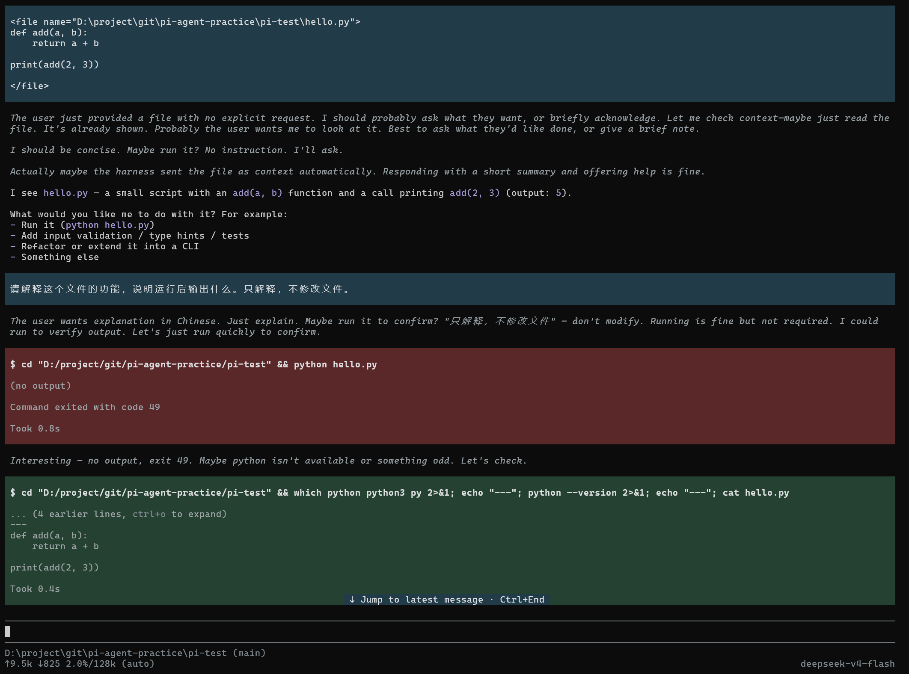

截图说明：上方是 `<file name="D:\project\git\pi-agent-practice\pi-test\hello.py">` 加完整文件内容的注入块，说明这是真正的文件引用而不是普通文本；模型据此解释 `add(a, b)` 与输出 `5`。画面下方还能看到 `python hello.py` 在 Pi 内置 bash 中返回 `exit 49`。

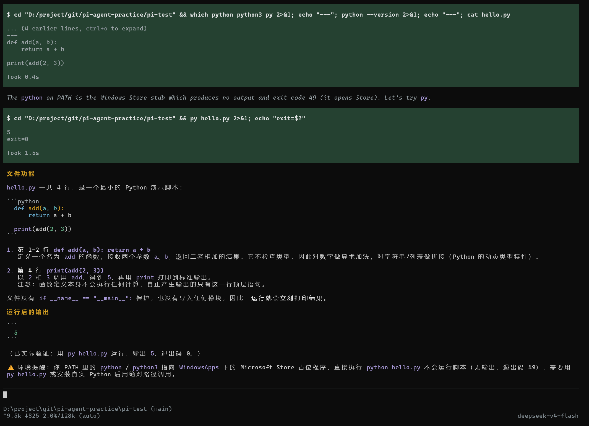

截图说明：模型给出中文解释“`add` 两参数相加、`print(add(2, 3))` 输出 `5`”，并实测 `py hello.py` 得到 `5`、退出码 `0`。核对结果：解释正确、文件未被修改、运行输出与预期一致。

### 2.5 任务四 B：粘贴小图片并测试（S5）

测试图是本目录下的 `s5-source.png`：200×200、白底、蓝色方块、黑色数字 7。先把图片放进剪贴板，再切到支持图片输入的模型：

```text
/model  →  Gemma 4
```

在输入区按 `Alt+V` 粘贴，Pi 会把剪贴板位图落盘为 `%TEMP%\pi-clipboard-<uuid>.png` 并把路径插入输入框，随后发送「请描述图片中的颜色、形状和数字。」

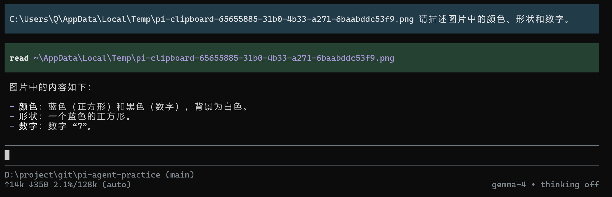

截图说明：输入框里可见 `pi-clipboard-…png` 引用路径与问题，发送后 `read` 工具读取该图片，回复「蓝色正方形 / 白色背景 / 数字 7」，底部状态栏为 `gemma-4`，可证明图片确实被识别而不是只贴了个路径。

原始小图附在下面，便于核对识别结果：


### 2.6 任务五：安装并使用一个插件（S6）

选用 `pi-web-access`（来源：[https://pi.dev/packages](https://pi.dev/packages) 的npm 包 `pi-web-access`）。作用是提供网页抓取与搜索能力，安装即用；无 Key 时走公共抓取通道。安装级别为个人级，所有项目可用。

```powershell
pi install npm:pi-web-access
```

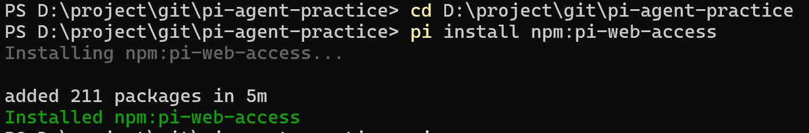

截图说明：命令返回 `added 211 packages in 5m` 与 `Installed npm:pi-web-access`，安装成功。

`pi list` 核对来源：

```text
User packages:
  npm:pi-web-access
    D:\APP\PiAgent\npm\node_modules\pi-web-access
```

退出会话后重新执行 `pi`，启动信息的 `[Extensions]` 区域列出该插件。

功能实测（成功案例）：

```text
请获取 https://www.baidu.com 的网页标题
```

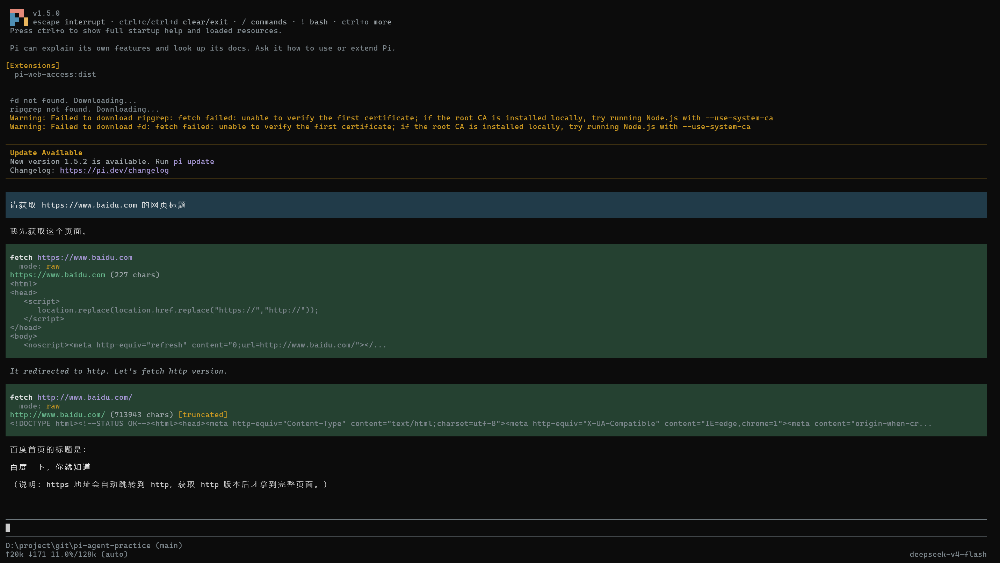

截图说明：画面顶部完整保留了这次重启后的启动信息——`[Extensions]` 下列出 `pi-web-access:dist`，底部状态栏为 `deepseek-v4-flash`。`fetch` 工具被调用，自动跟随 https → http 跳转，返回标题「百度一下，你就知道」。

### 2.7 任务六：安装 pptx Skill（S7）

按作业提示词让 Pi 自己下载安装：

```text
请从 https://github.com/anthropics/skills 下载 skills/pptx 完整目录，安装到当前项目的 .pi/skills/pptx。
保留 SKILL.md、LICENSE.txt 和 scripts 等支持文件，记录源 commit。
只安装这个 Skill，不修改其他项目，不自动安装依赖；如目标已存在先说明情况。完成后列出目录结构。
```

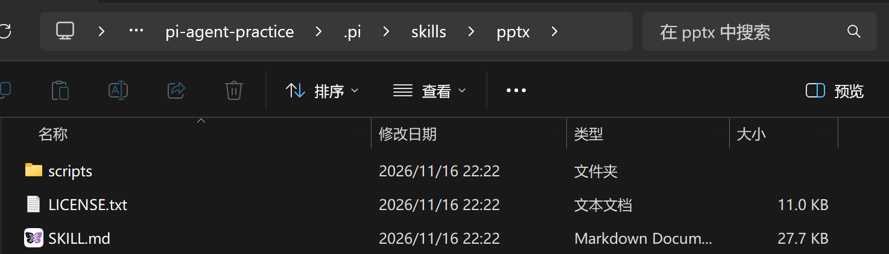

截图说明：资源管理器地址栏可辨认 `pi-agent-practice > .pi > skills > pptx`，列表中含 `scripts`、`LICENSE.txt`、`SKILL.md`。

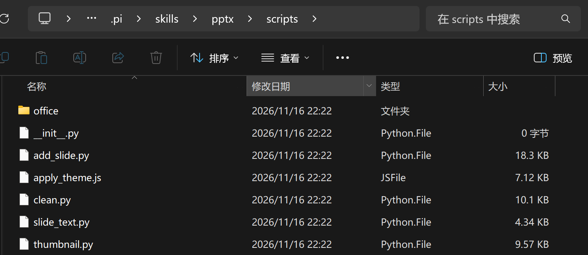

截图说明：`scripts` 目录内的 `add_slide.py`、`apply_theme.js`、`clean.py`、`slide_text.py`、`thumbnail.py` 与 `office/` 子目录。

### 2.8 任务六：启动发现与实际调用（S8）

完全退出会话后，在项目目录重新执行 `pi`。首次会提示 `Trust project folder?`，必须选择 **Trust**，否则项目 `.pi` 下的资源不会加载。

```powershell
cd D:\project\git\pi-agent-practice
pi
```

```text
/skill:pptx 请说明这个 Skill 的名称、用途和所在目录，
```

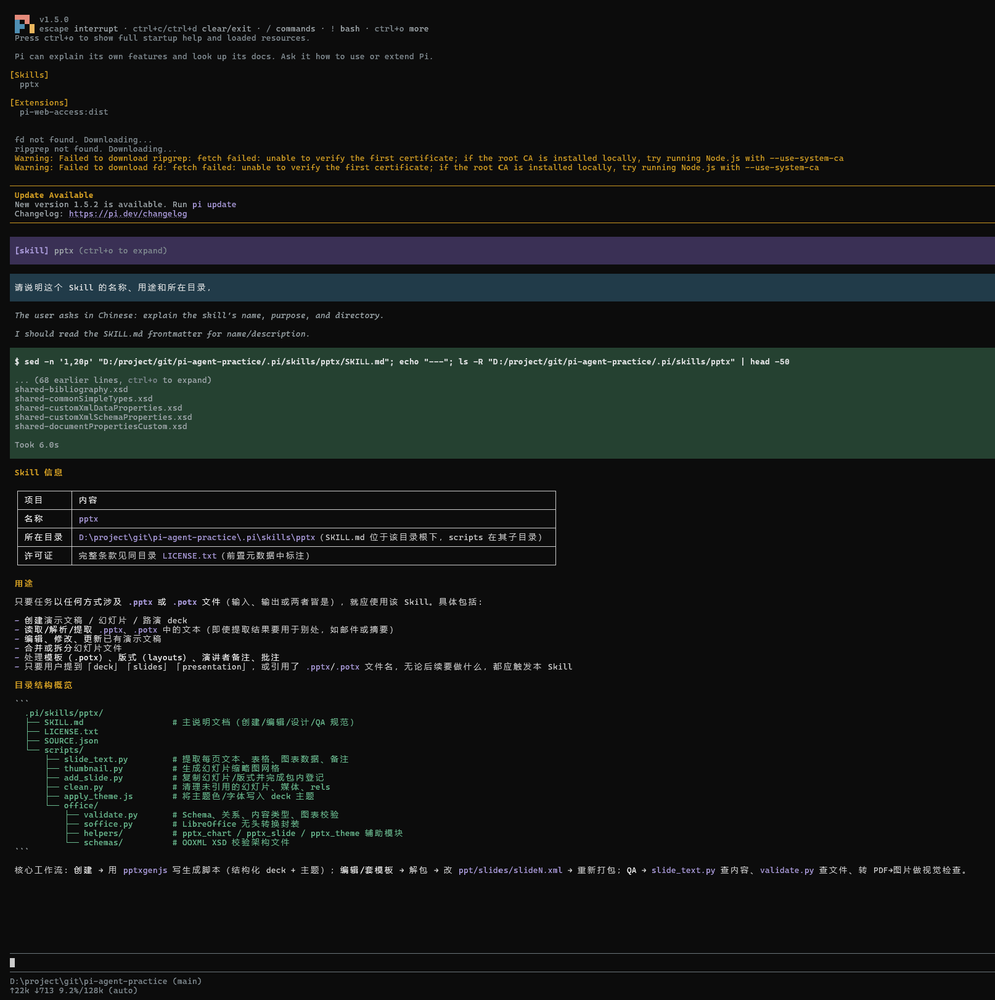

截图说明：启动信息中 `[Skills]` 出现 `pptx`，画面显示 `/skill:pptx` 的调用、读取 `SKILL.md` 的工具调用，以及回复中的名称 `pptx`、所在目录 `D:\project\git\pi-agent-practice\.pi\skills\pptx`、许可证说明与目录结构。

## 3. 问题与解决

**问题1：PowerShell 无法运行启动脚本**

- 现象：执行 `pi` 报 `PSSecurityException`，提示脚本被禁止运行。
- 原因：Windows 默认执行策略限制了本地脚本。
- 解决：把 `CurrentUser` 执行策略设为 `RemoteSigned` 后重新打开终端，`pi --version` 正常。

**问题2：输入** `@` **时候选文件浮层不渲染**

- 现象：在 1.5.0 + Windows Terminal 下打 `@` 没有弹窗，手打 `@hello.py` 只当普通文本，模型改用 `ls` 自查。
- 原因：该版本 TUI 的补全浮层在此终端组合下不渲染（仓库根与 `pi-test` 都复现）。
- 解决：改用官方支持的命令行 `@文件` 形式（`pi "@hello.py"` 启动后提问），文件以 `<file name=…>` 注入上下文；`-p` 模式下 `@` 后不能跟空格提示词，否则整段被当文件名报 `File not found`。

**问题3：**`Alt+V` **粘贴后输入框显示的是文件路径而不是缩略图**

- 现象：粘贴后出现 `pi-clipboard-<uuid>.png` 字样，看起来像没贴上。
- 原因：1.5.0 在 Windows 上的既定设计——先把剪贴板位图落盘为临时 PNG，再把路径插入输入框。
- 解决：正常发送即可，`read` 会读取该文件并识别内容（白底、蓝色正方形、数字 7）。